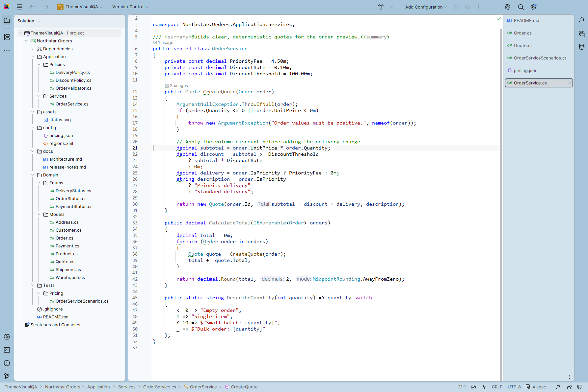
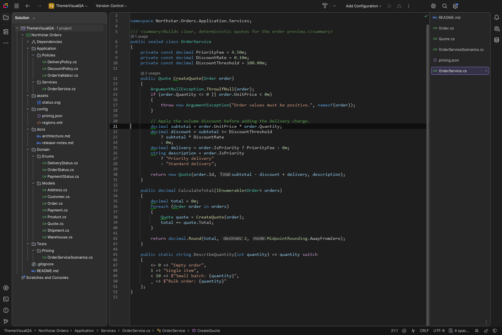
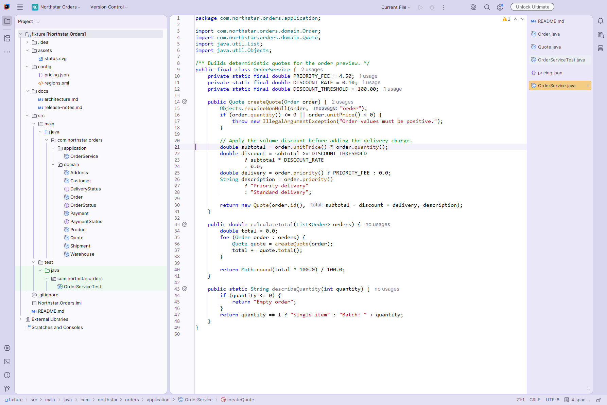
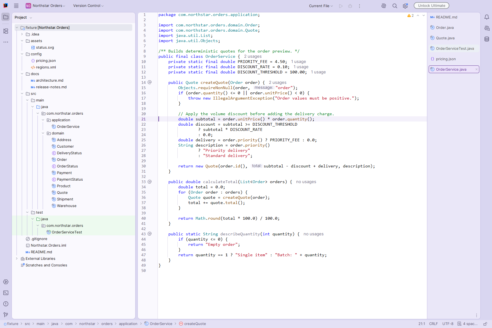
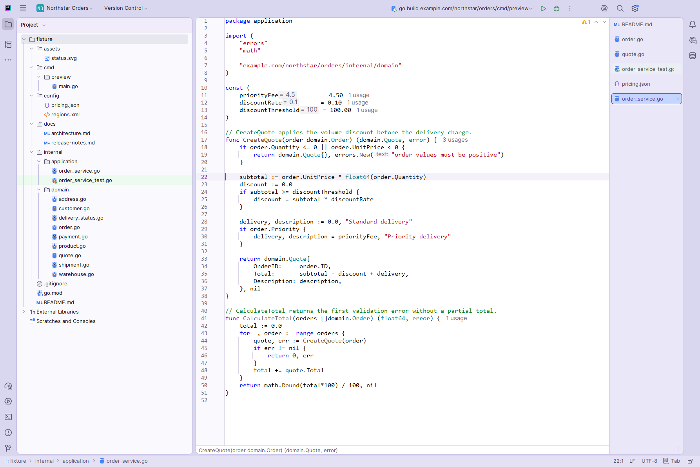
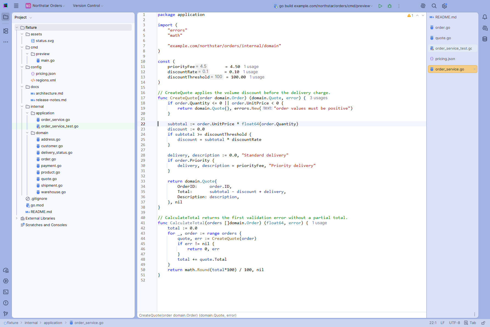
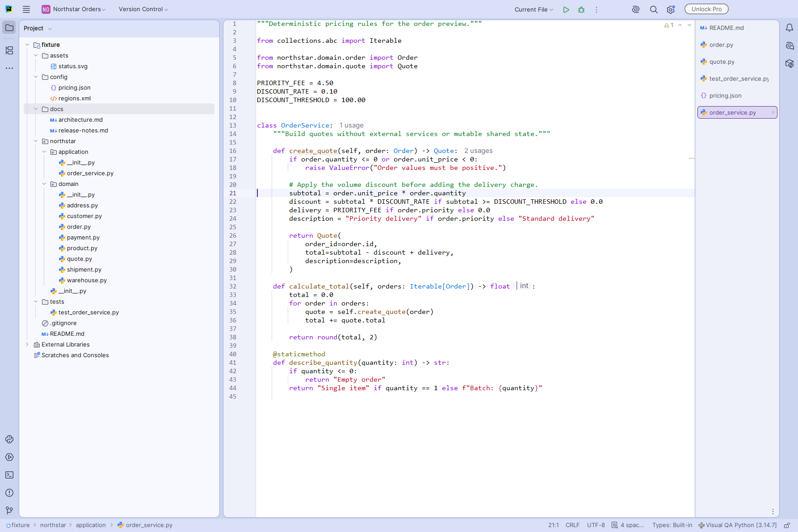
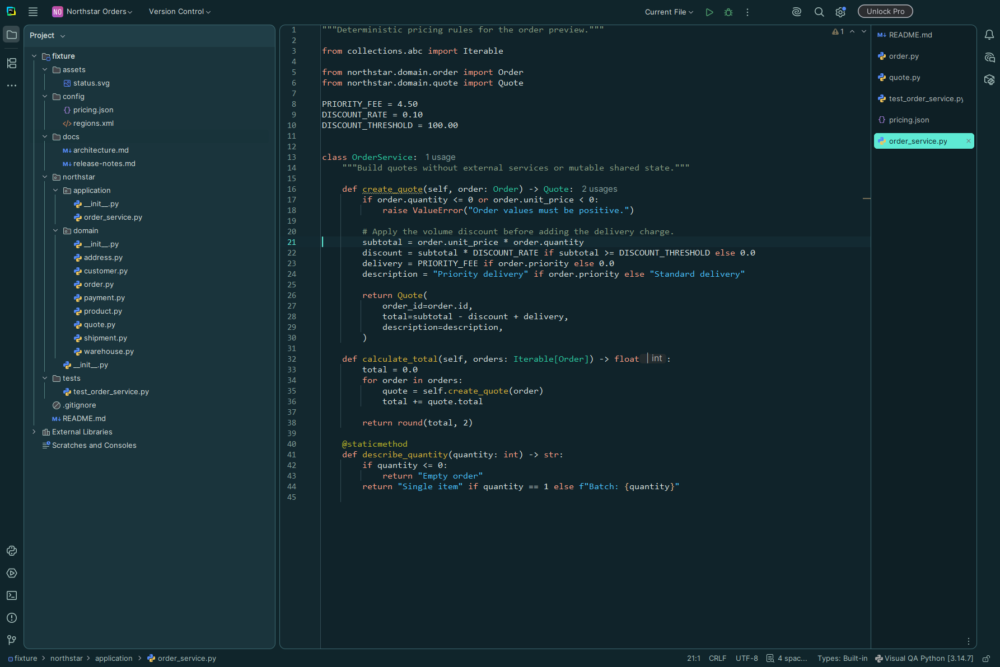

# FlexThemes

[](https://plugins.jetbrains.com/plugin/35464-flexthemes)
[](https://plugins.jetbrains.com/plugin/35464-flexthemes)

FlexThemes is the collection of Visual Studio-inspired themes JetBrains tools have always been missing: calm colors,
clear panel edges and easy-to-read code. JetBrains comes first; Visual Studio and VS Code themes are planned.


*Periwinkle Night in Rider*

## Screenshots

Nine light and dark appearances for Rider, IntelliJ IDEA, GoLand and PyCharm. Real captures from the IDEs, without
edits: C# in Rider, Java in IntelliJ IDEA, Go in GoLand and Python in PyCharm.

| | |
|---|---|
| <br>**Morning Mist** · Rider | <br>**Graphite** · Rider |
| <br>**Lavender Mist Gold** · IntelliJ IDEA | <br>**Lavender Mist Indigo** · IntelliJ IDEA |
| <br>**Lavender Mist Blue** · GoLand | <br>**Blue Mist** · GoLand |
| <br>**Periwinkle Islands** · PyCharm | <br>**Abyss** · PyCharm |

## Get the themes

| Platform | Folder | Status |
|---|---|---|
| JetBrains IDEs | [jetbrains/](jetbrains/README.md) | FlexThemes 0.7.1 on [JetBrains Marketplace](https://plugins.jetbrains.com/plugin/35464-flexthemes): one bundle with every theme. [GitHub Releases](https://github.com/pbednarcik/FlexThemes/releases) also have one plugin per theme family |
| Visual Studio, VS Code | | planned |

The JetBrains themes need a 2026.2 IDE with the Islands UI. They are tested in Rider, IntelliJ IDEA, GoLand and
PyCharm; other JetBrains IDEs based on 2026.2 may work too, but have not been tested. Installing, the theme list and
the settings a theme cannot carry are in the [JetBrains README](jetbrains/README.md).

## Build

From the JetBrains project folder with Python, on Windows, macOS or Linux:

```bash
cd jetbrains
python tools/build.py
```

The build reads the installed IDEs; the [JetBrains README](jetbrains/README.md#build) lists what it needs.

## License

Apache-2.0; see [LICENSE](LICENSE). Platform projects retain their own attribution notices, including [jetbrains/NOTICE](jetbrains/NOTICE).
