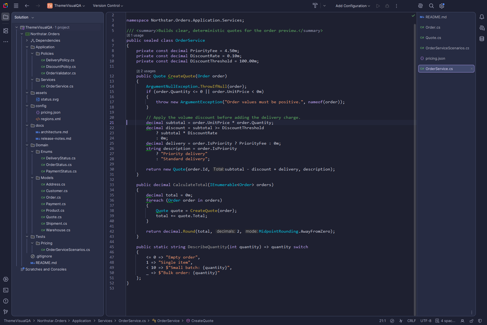

# Visual Studio-inspired themes for JetBrains IDEs

These are the themes I always missed in JetBrains IDEs. Moving from Visual Studio to Rider was always a bit of a
struggle for me: Visual Studio’s interface is so polished, with calm colors, clear panel edges and easy-to-read code.
This collection brings that clarity to JetBrains tools.

One bundle with nine appearances for **Rider, IntelliJ IDEA, GoLand and PyCharm**. They share panel-separation rules
and semantic language mappings while retaining each theme's own colours.



*Periwinkle Night in Rider. Every appearance is shown in the [screenshots](../README.md#screenshots).*

Morning Mist and Graphite use colours decoded from Visual Studio 2026's own theme data (its Cool Breeze and Dark
themes); Morning Mist's are also checked against pixel samples of Visual Studio. Blue Mist, Lavender Mist and
Periwinkle Islands are designed themes inspired by the classic Visual Studio Blue theme; Periwinkle Night and Abyss
are dark designs of their own.

## Install

1. Download `flex-themes-<version>.jar` from the [GitHub Releases page](https://github.com/pbednarcik/FlexThemes/releases), or [build the bundle](#build) (it is written to `dist/`). Standalone jars for each family are attached to the same release if you prefer just one family.
2. Uninstall any of the corresponding standalone theme plugins before installing the bundle; they register the same themes and editor schemes. The bundle declares those plugin IDs incompatible to prevent duplicates.
3. In your JetBrains IDE: `Settings > Plugins > gear icon > Install Plugin from Disk…`, choose the jar, restart if asked.
4. Choose the theme under `Settings > Appearance & Behavior > Appearance > Theme`. Its editor scheme switches with it; Lavender Mist also offers a separate Purple editor scheme.

Requires JetBrains IDEs 2026.2 or later with the Islands UI.

**Tested on:** Rider 2026.2.3.1 (262.10968.170), IntelliJ IDEA 2026.2.3 (262.10968.63), GoLand 2026.2.3
(262.10968.67) and PyCharm 2026.2.3 (262.10968.92), on Windows. Earlier 2026.2 updates, later releases and other
JetBrains IDEs (WebStorm, CLion, RustRover and so on) may work but have not been tested.

**New UI only.** The themes are built on the Islands themes of the new UI and are offered only while the new UI
is on; with the classic UI they do not appear in the theme list. To use them with the classic UI, clone this
repository and adapt the theme maps to a classic base theme.

### Theme family

| Plugin | Appearances | Palette |
|---|---|---|
| Morning Mist | Morning Mist | Light blue frame, near-white panes, Visual Studio syntax |
| Lavender Mist | Gold, Indigo, Blue | Lavender frame with palette-specific selected tabs and focus cues |
| Blue Mist | Blue Mist | Blue frame and gold active tab |
| Periwinkle Islands | Periwinkle Islands | Light periwinkle frame with purple accents |
| Graphite | Graphite | Neutral dark surfaces and Visual Studio syntax distinctions |
| Periwinkle Night | Periwinkle Night | Indigo surfaces and lavender accents |
| Abyss | Abyss | Ocean surfaces with turquoise accents |

Every build checks the themes against the four installed IDEs: every UI key and all 275 language highlighting keys
per editor scheme must exist there, text must meet its contrast minimum, and panels must stay clearly separated.
Each release is also checked in Rider, IntelliJ IDEA, GoLand and PyCharm with real screenshots: every appearance
and editor scheme, with the editor focused, the project tree focused and text selected. That screenshot check is kept
outside this repository; the build checks are described in [Development](docs/Development.md#checks).

### Settings a theme cannot carry

| Setting | Where | Value |
|---|---|---|
| Editor font | `Editor > Font` | the font you use in Visual Studio, for example Cascadia Mono; size 14 to 15 corresponds to 11 pt there; line height 1.0 to 1.1, ligatures off |
| Editor antialiasing | `Appearance & Behavior > Appearance > Antialiasing > Editor` | Subpixel, the closest to Visual Studio's ClearType |
| Parameter name hints | `Editor > Inlay Hints > C# Parameter Name Hints` | off, if your Visual Studio does not show them |
| Scroll bar map | a minimap plugin such as CodeGlance Pro | Visual Studio's map mode has no built-in counterpart |

## Personal overrides

Visual Studio users often customise Fonts and Colors. `tools/extract_vssettings_colours.py` reads that section
(and only that section) from a `.vssettings` export. Put your values in `personal/overrides.json`, following
[docs/overrides.example.json](docs/overrides.example.json), and build the family they were made for:

```
python tools/build.py --plugin MorningMist --overrides personal/overrides.json
```

Overrides are laid over that family's own maps and still pass every contrast check, so colours chosen for a light
theme are refused by a dark one. The jar gets the suffix `-personal`. The `personal/` folder is ignored by git.

## Build

```
python tools/build.py
```

### What the build needs

| Requirement | Notes |
|---|---|
| Windows, macOS or Linux | `tools/build.py` is plain Python. It is tested on Windows; macOS and Linux are supported but not yet tested. Generated files and jars are written with LF line endings, fixed entry dates and a fixed entry order, so the same inputs give the same files on every system. |
| Python 3.10+ with Pillow | `python -m pip install -r requirements.txt`; tested with Python 3.14 and Pillow 12.2.0. Pillow is needed even with `--skip-visual-check`, because the package checks import it. |
| JDK 21 or later | `javap`, from PATH or `JAVA_HOME`. |
| Rider, IntelliJ IDEA, GoLand, PyCharm 2026.2 | Read-only. Found in the usual places (`%LOCALAPPDATA%\Programs` on Windows, `/Applications` or `~/Applications` on macOS), or pass `--home RD=<path>` and likewise `IU`, `GO`, `PY`; on macOS the path is the `.app`. On Linux pass all four. The build checks the theme keys and language declarations against these installs, and the frozen palettes against the builds listed under Install. A newer IDE build can add keys or change a base scheme: the build then stops, and the change needs a review before the baselines are refreshed. |
| Visual Studio 2026 | Optional; see below. |

`--plugin Bundle` and `--plugin All` build all seven current standalone packages and the combined bundle, then remove older numeric release JARs for those known families only after verification succeeds. Personal and unrelated files are left alone. `--plugin <name>` builds and verifies just that standalone plugin.
Release builds also run the native screenshot comparison described above. That gate is not part of this
repository, so a build from a clone reports it as skipped; `--skip-visual-check` skips it explicitly. No normal IDE
profile is modified. No Gradle. Visual Studio is optional: the build uses the committed
snapshots in `src/**/vs-values/`, which hold exactly the values the themes use. `--refresh-vs` (or `--vs-home <path>`)
decodes an installed Visual Studio 2026 into `data/vs-<version>/` and refreshes the snapshots from it; the build
never does that on its own. Both routes produce byte-identical output.

Tests, the build checks and the map format are described in [Development](docs/Development.md).

## Layout

```
src/                  Morning Mist; the other families in src/<family>/: theme and scheme maps, UI contracts,
                      Visual Studio value snapshots, descriptor template and icon
src/common/           shared theme and scheme bases, and the language role mappings
src/bundle/           the FlexThemes bundle descriptor and changelog
tools/                build, generator, checks and helpers
docs/Development.md   how the themes are built and checked
docs/screenshots/     the screenshots shown in the READMEs
```

## Licence and trademarks

Apache License 2.0, see [LICENSE](LICENSE) and [NOTICE](NOTICE). The built jars contain files derived
from JetBrains' Islands Light and Islands Dark themes and the Visual Studio Light and Visual Studio Dark
schemes, all Apache-2.0; the NOTICE file lists which theme derives from which and what was changed. No
Microsoft artwork, icon assets or font files are bundled. The images in `docs/screenshots/` show the JetBrains
IDEs' own interface with these themes; they are documentation only and not part of the plugins.

Not affiliated with, sponsored by or endorsed by Microsoft or JetBrains. Visual Studio is a trademark of the
Microsoft group of companies; JetBrains, IntelliJ IDEA, Rider, GoLand and PyCharm are trademarks of
JetBrains s.r.o.
